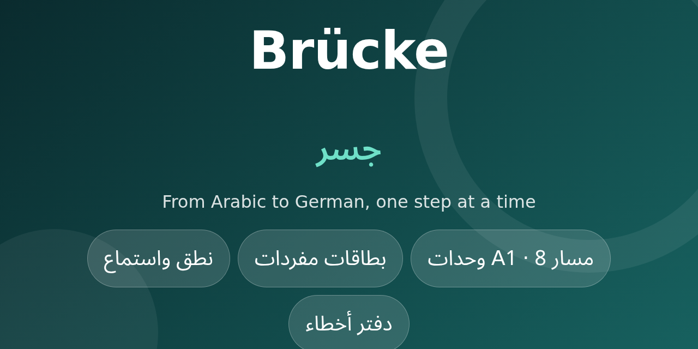
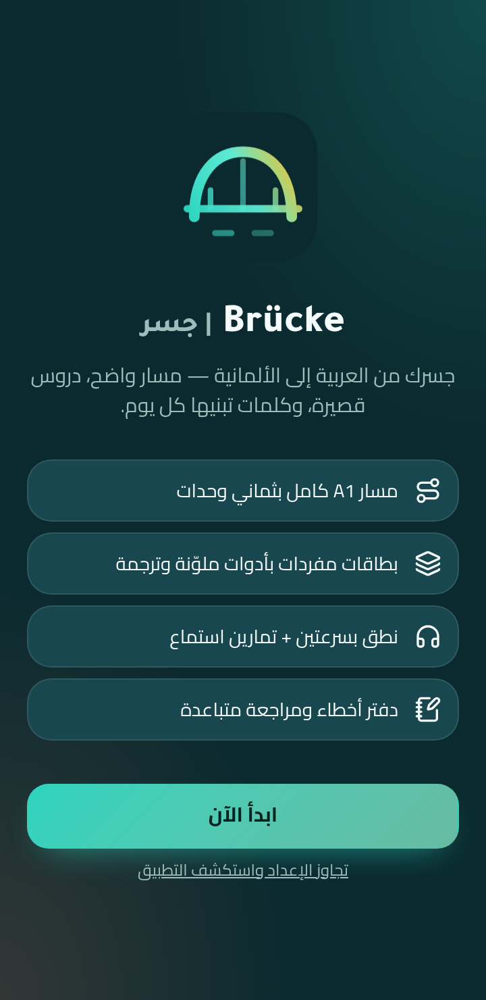

<b><a href="https://bruecke-bridge.pages.dev">Open the app | افتح التطبيق</a></b> Web app · Arabic interface · Early version

## عن التطبيق

جسر من العربية إلى الألمانية: مسار A1 من 8 وحدات، قصص، بطاقات مفردات بأدوات ملوّنة وترجمة، نطق بسرعتين وتمارين استماع، ودفتر أخطاء بمراجعة متباعدة. يتضمن 412 مقطعًا صوتيًا مسجّلاً، وصوت الجهاز للجمل غير المسجّلة.

> **حدود النسخة الحالية:** نسخة مبكرة. بعض مستويات القصص مقفلة. إرشادات النطق مبسّطة وقد لا تكون دقيقة تمامًا (مثل صوت ch) وما زالت تحت المراجعة. لم يُجرَّب على هاتف حقيقي، ولم تراجعه مدرّسة أو مدرّس ألماني.

## About

A bridge from Arabic to German: an A1 path of 8 units, stories, vocabulary cards with colored articles and translation, pronunciation at two speeds with listening exercises, and a mistake notebook with spaced review. Includes 412 recorded audio clips; the device voice reads sentences that have no recording.

> **Current limits:** Early version. Some story levels are locked. Pronunciation tips are simplified and may be imprecise (for example the ch sound); they are still being proofread. Not tried on a real phone. Not reviewed by a German teacher.

## Features | المزايا

| Feature | الميزة |
| --- | --- |
| A1 path, 8 units | مسار A1 من 8 وحدات |
| Vocabulary cards with colored articles | بطاقات مفردات بأدوات ملوّنة |
| Pronunciation at two speeds + listening | نطق بسرعتين وتمارين استماع |
| Mistake notebook, spaced review | دفتر أخطاء ومراجعة متباعدة |

## Updates

See [CHANGELOG.md](CHANGELOG.md).

Source code is not published in this repository.
